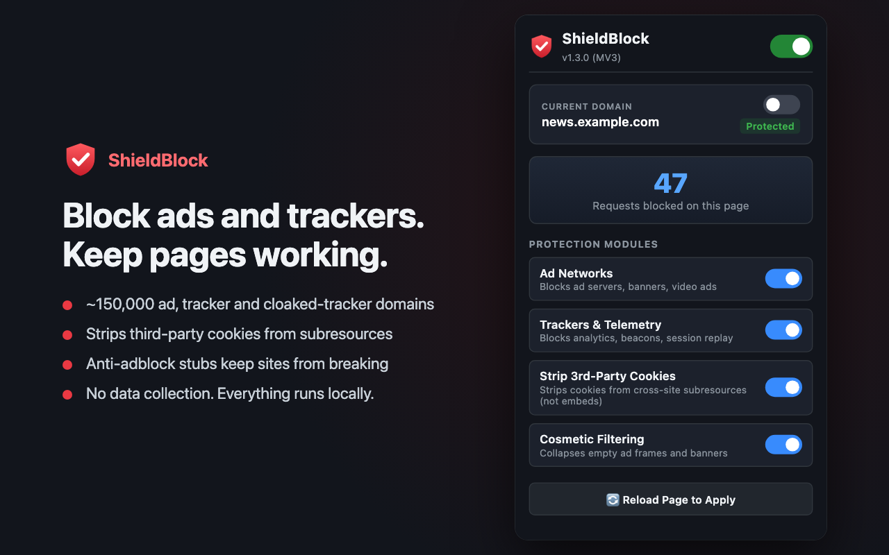

# ShieldBlock - High-Performance Ad & Tracker Blocker (Manifest V3)

[](https://github.com/arminsalmasi/chrome-ad-blocker/actions/workflows/ci.yml)
[](LICENSE)


**ShieldBlock** is a lightweight, privacy-focused Chrome Extension built on **Manifest V3 (MV3)**. It combines native `declarativeNetRequest` (DNR) domain filtering (~150,000 ad and tracker domains), cosmetic CSS element collapsing, anti-adblock scriptlet defusers, and dynamic per-site allowlisting. It collects no data; see the [privacy policy](PRIVACY.md).



---

## Key Features & Architecture

### 1. Network Blocking (DNR Engine)
- **Native Evaluation**: Requests are matched inside Chrome's DNR engine; no request interception runs in the service worker.
- **Modular Static Rulesets**:
  - `rules/ads.json`: About 40,600 ad, tracking, and malware domains: the hand-picked seed list (`scripts/sample_ads.txt`) merged with a snapshot of [StevenBlack/hosts](https://github.com/StevenBlack/hosts) (MIT), which unifies AdAway, URLHaus, and other curated hosts lists.
  - `rules/trackers.json`: About 111,000 tracker domains: telemetry, analytics, and session-replay seed lists plus a snapshot of [AdGuard's CNAME-disguised trackers list](https://github.com/AdguardTeam/cname-trackers) (MIT), i.e. first-party-looking subdomains such as `metrics.site.com` that alias a tracker. Matching is by hostname from a static list; no DNS lookups are performed.
  - `rules/cookie_protection.json`: Strips third-party `Cookie` and `Set-Cookie` headers from subresources only (scripts, images, XHR, media, fonts, etc.). Top-level and embedded frames keep their cookies, so iframes and logins keep working. Federated SSO, captcha, and payment domains (Google, Microsoft, Apple, GitHub, Okta, Auth0, Stripe, PayPal, hCaptcha, reCAPTCHA, Cloudflare challenges) are excluded.
- **Compiler**: `scripts/build_rules.py` converts hosts, plain-domain, and whole-domain Adblock Plus lists into grouped DNR rules (1,000 domains per rule via `requestDomains`), so large lists stay well inside Chrome's 30,000 guaranteed static rules. See [Filter-List Compiler](#filter-list-compiler-scriptsbuild_rulespy).

### 2. Cosmetic Filtering (`content/cosmetic.css`)
- **Static Element Hiding**: `display: none !important` for common ad containers, Taboola/Outbrain/Revcontent/MGID widgets, `amp-ad`, and AdSense `amp-embed`.
- **Publisher Ad Slots**: Hides site-styled placeholder containers that stay visible after their ad is blocked (`.ad-slot`, `.ad-slot-container`, `.ad-slot-header__wrapper`, `.ad-slot__*`, `.container__ads`, `[data-ad-label-text]`).
- **Relational Selectors (`:has()`)**: Collapses `div`/`aside` wrappers left behind by blocked ad units (`.adsbygoogle`, `[id^="div-gpt-ad"]`, ad-network iframes, and similar), but only when every child element is ad content. Wrappers that also contain article text stay visible.
- **Registration-Based Control**: Registered as a content-script stylesheet at `document_start` in all frames. It is only active while the Cosmetic Filtering module is enabled and the site is not allowlisted.

### 3. Scriptlet Stubs & Anti-Adblock Defusers (`content/scriptlets_ads.js`, `content/scriptlets_trackers.js`)
Both files run in the page's own context (`world: "MAIN"`) at `document_start` in all frames.

**`scriptlets_ads.js`** (Ad Networks module):
- **Ad SDK Stubs**: No-op replacements for `adsbygoogle`, Google Publisher Tag (`googletag`), Prebid.js (`pbjs`), Amazon TAM (`apstag`), Taboola (`_taboola`), and Outbrain (`OBR`). Queued `googletag.cmd`/`pbjs.que` functions and `adsbygoogle.push` callbacks fire immediately. `window.google` is deliberately left untouched, because stubbing it breaks pages that feature-detect Google Sign-In or Maps.
- **Canary Flags**: Pins `canRunAds`, `canRunAdvertise`, `googleAdSenseLoaded` to `true` and `isAdBlockActive`, `adblockEnabled` to `false`. Page assignments are ignored.
- **Anti-Adblock Libraries**: Replaces `blockAdBlock`, `fuckAdBlock`, and `sniffAdBlock` with inert objects that report "not detected".
- **Bait Spoofing**: Intercepts `getComputedStyle` and `offsetHeight` for bait classes (`adsbox`, `ad-banner`, `pub_300x250`, `ad-placement`, `banner-ad`) so they report visible, non-zero dimensions.
- **Polling Defuser**: Replaces `setInterval` callbacks whose source references anti-adblock identifiers (`canRunAds`, `isAdBlockActive`, `blockAdBlock`, `fuckAdBlock`, `sniffAdBlock`) with an inert timer.

**`scriptlets_trackers.js`** (Trackers & Telemetry module): Stubs `dataLayer`, `gtag`, `ga`, `fbq`/`_fbq`, `twq`, `lintrk`, `ttq`, `hj`, `FS`, `mixpanel`, `analytics`, `clarity`, and `ym`, so page code does not throw when the real library is blocked. `ttq`, `FS`, `mixpanel`, and `analytics` are universal no-op proxies, so any method chain (for example `mixpanel.people.set()`) is safe. Callbacks passed to these APIs (`eventCallback`, `event_callback`, `hitCallback`, and analytics callbacks) fire immediately so purchase flows and buttons never stall.

### 4. Popup UI, Dynamic Allowlisting & Badge
- **Global Master Switch**: Disables all DNR rulesets, the allowlist rule, and all content scripts.
- **Per-Site Allowlist**: Adds a single dynamic `allowAllRequests` rule (priority 100) on `main_frame` covering all allowlisted domains. An entry also covers its subdomains. `www.` is stripped when an entry is added.
- **Granular Module Controls**: Independently toggle Ad Networks, Trackers & Telemetry, Third-Party Cookie Stripping, or Cosmetic Filtering.
- **Blocked Request Counter**: The extension badge shows the native per-tab DNR match count (`displayActionCountAsBadgeText`), which works in packed builds. The popup count comes from `getMatchedRules` and only includes the Ad Networks and Trackers rulesets, so the two numbers can differ.

**State model**: `storage.local` is the single source of truth. The popup only writes to storage. The service worker reacts to `storage.onChanged` and runs one serialized sync that reconciles static rulesets, the allowlist rule, and registered content scripts. Changes apply on the next page load; the popup's **Reload Page to Apply** button reloads the active tab.

---

## Installation (Load Unpacked in Chrome)

1. Clone or download this repository.
2. Open Google Chrome and go to `chrome://extensions/`.
3. Enable **Developer mode** in the top-right corner.
4. Click **Load unpacked** and select the repository root directory.
5. Pin **ShieldBlock** to your Chrome toolbar.

**Requirements**: Chrome 119 or newer (`minimum_chrome_version`).

**Publishing to the Chrome Web Store**: run `make package` and upload `dist/shieldblock-<version>.zip`. Listing text, permission justifications, data-use answers, and a pre-submit checklist are in [STORE_LISTING.md](STORE_LISTING.md); the privacy policy is [PRIVACY.md](PRIVACY.md); graphics are in `store/` (regenerate with `make assets`).

**Permissions**: `declarativeNetRequest`, `scripting`, `storage`, `activeTab`, and host access to `<all_urls>`. `activeTab` is used by the popup to read the match count for the current tab.

---

## Extension Controls & Usage

Click the **ShieldBlock** toolbar icon to access:

| Control | Type | Description |
| :--- | :--- | :--- |
| **Master Toggle** | Header switch | Disables all static rulesets, the allowlist rule, and all content scripts. Module toggles are disabled while off. |
| **Site Allowlist** | Domain card | Adds or removes the active domain (and its subdomains) from the allowlist. Applies on reload. |
| **Ad Networks** | Module | Controls `ruleset_ads` (`rules/ads.json`) and the ad scriptlets (`content/scriptlets_ads.js`). |
| **Trackers & Telemetry** | Module | Controls `ruleset_trackers` (`rules/trackers.json`) and the tracker stubs (`content/scriptlets_trackers.js`). |
| **Strip 3rd-Party Cookies** | Module | Controls `ruleset_cookies` (`rules/cookie_protection.json`). |
| **Cosmetic Filtering** | Module | Controls the cosmetic stylesheet (`content/cosmetic.css`). |
| **Badge Counter** | Status badge | Native per-tab count of matched DNR rules. |

---

## Filter-List Compiler (`scripts/build_rules.py`)

Compile hosts files, plain domain lists, or Adblock Plus lists into MV3 DNR rulesets. Domains are grouped into rules with `condition.requestDomains` (`--domains-per-rule`, default 1,000), which matches each domain and its subdomains like `||domain^`. Subdomains already covered by a listed parent are dropped. Requires Python 3.10+. `--input` is required and may be repeated.

**Accepted lines** block an entire domain: hosts entries (`0.0.0.0 example.com`), plain domains, and `||example.com^` with no options or only `$important`/`$all`. Rules with `$third-party`, `$popup`, `$document`, or type options are skipped, because the generated rule has no such restriction and would block more than the original.

**Skipped lines**: cosmetic and scriptlet filters (`##`, `#@#`, `#?#`, `#$#`, and similar), exceptions (`@@`), paths, wildcards, regexes, ports, and type- or domain-restricted options. These are never widened into site-wide blocks.

**Upstream aliases**: `stevenblack`, `adguard_dns`, `easylist`, `easyprivacy`, `cname_trackers`. Any `http(s)://` URL or local file path is also accepted.

**Exclusions**: `--exclude FILE` (repeatable) lists domains that must never be blocked. They are removed from the input and added to every rule as `excludedRequestDomains`, so a listed parent domain can't block them either. The build uses `scripts/exclude_domains.txt`; add a domain there when a blocklist entry breaks a site.

**Snapshots**: `--dump-domains PATH` writes the cleaned domain list instead of rules. Upstream lists are snapshotted into `scripts/lists/` so `make rules` is deterministic and works offline. A `.gz` path is written gzipped (byte-reproducible), and `.gz` inputs are read transparently.

Each generated file with a new prefix is a new ruleset. The compiler prints the `rule_resources` entries to add to `manifest.json`; new files are inert until added there.

```bash
# Compile from local seed lists
python3 scripts/build_rules.py -i scripts/sample_ads.txt -o rules -p custom_blocklist

# Compile from upstream lists, with exclusions
python3 scripts/build_rules.py \
  --input stevenblack \
  --input cname_trackers \
  --exclude scripts/exclude_domains.txt \
  --output-dir rules \
  --prefix blocklist
```

---

## Repository Structure

```text
├── manifest.json                  # Manifest V3 configuration, permissions, ruleset declarations
├── background.js                  # Service worker: state sync, allowlist rule, content script registration
├── Makefile                       # Build (rules), test, and check targets
├── LICENSE                        # MIT License
├── PRIVACY.md                     # Privacy policy (linked from the Web Store listing)
├── STORE_LISTING.md               # Copy-paste Web Store listing, permission justifications, checklist
├── content/
│   ├── cosmetic.css               # Cosmetic element hiding and :has() collapse rules
│   ├── scriptlets_ads.js          # Ad SDK stubs and anti-adblock defusers (MAIN world)
│   └── scriptlets_trackers.js     # Analytics and pixel stubs (MAIN world)
├── icons/
│   ├── icon16.png                 # Toolbar icon (16x16)
│   ├── icon32.png                 # High-DPI icon (32x32)
│   ├── icon48.png                 # Extensions management icon (48x48)
│   └── icon128.png                # Chrome Web Store icon (128x128)
├── popup/
│   ├── popup.html                 # Popup user interface
│   ├── popup.css                  # Dark-themed styling
│   └── popup.js                   # Writes settings to storage and handles toggle events
├── rules/
│   ├── ads.json                   # Static DNR rules: ad seed list + StevenBlack hosts snapshot
│   ├── trackers.json              # Static DNR rules: tracker seed lists + AdGuard CNAME snapshot
│   └── cookie_protection.json     # DNR modifyHeaders rules stripping third-party cookies
├── scripts/
│   ├── build_rules.py             # Python compiler converting filter lists into grouped DNR rulesets
│   ├── exclude_domains.txt        # Domains never blocked (applied to every generated rule)
│   ├── lists/
│   │   ├── stevenblack.txt.gz     # Snapshot of StevenBlack/hosts (source for rules/ads.json)
│   │   └── adguard_cname.txt.gz   # Snapshot of AdGuard CNAME trackers (source for rules/trackers.json)
│   ├── sample_ads.txt             # Seed list of ad network domains (source for rules/ads.json)
│   ├── sample_trackers.txt        # Seed list of tracker domains (source for rules/trackers.json)
│   ├── sample_cname.txt           # Known CNAME-cloaked tracker subdomains (source for rules/trackers.json)
│   └── render_assets.py           # Renders icons and Web Store graphics with headless Chrome
├── store/                         # Web Store screenshots (1280x800) and promo tile (440x280)
├── tests/
│   └── test_build_rules.py        # Unit tests for the compiler
├── .github/
│   └── workflows/
│       └── ci.yml                 # CI: unit tests, syntax/JSON checks, rulesets match seed lists
├── APPROACH_CLAUDE.md             # In-depth architectural analysis of Claude's blanket 3rd-party design
└── APPROACH_GEMINI.md             # In-depth architectural analysis of Gemini's targeted DNR design
```

---

## Development

```bash
make rules         # Regenerate rules/ads.json and rules/trackers.json from local inputs
make update-lists  # Download fresh upstream snapshots into scripts/lists/, then make rules
make test          # Run the unittest suite in tests/
make check         # node --check on extension JS and JSON validation for manifest and rulesets
make assets        # Re-render icons/ and store/ graphics (needs Google Chrome; CHROME=... to override)
make package       # Build dist/shieldblock-<version>.zip for Web Store upload (runtime files only)
```

CI runs `test`, `check`, and `rules` on pushes to `main` and on pull requests, and fails if `make rules` changes anything under `rules/`. After editing a seed list or the exclusion file, run `make rules` and commit the regenerated files. To pick up upstream changes, run `make update-lists` and commit both `scripts/lists/` and `rules/`.

---

## Limitations

- **Reload required**: Setting and allowlist changes apply on the next page load.
- **Scriptlets are not retroactive**: Stubs and defusers only take effect for documents loaded after they are registered. They cannot undo changes in an already-loaded page.
- **Frame coverage**: Content scripts run on `http://` and `https://` pages and, via `matchOriginAsFallback`, in `about:blank`/`srcdoc`/`blob:` frames those pages create. Other schemes (`file://`, `chrome://`, extension pages) are not covered.
- **Allowlist scope differs per layer**: Network rules are exempted for the whole tab when the top-level site is allowlisted. Content scripts are excluded per frame URL, so third-party iframes inside an allowlisted page (for example a payment or captcha frame) still get the stubs and cosmetic CSS.
- **IPv6 hosts** (`[::1]`) cannot be allowlisted. The toggle is disabled for them.
- **Badge vs. popup count**: The badge is Chrome's native count of blocked requests on the tab. The popup counts ad and tracker rule matches.
- **Network lists don't hide site-specific placeholders**: Domain lists block ad *requests*. Empty ad slots that a site styles itself (fixed-height containers with site-specific classes) stay visible, because hiding them needs per-site cosmetic filters (EasyList `##` rules), which the compiler deliberately skips.
- **Package size**: The bundled rulesets are about 5 MB (~150,000 domains in ~150 rules, well within Chrome's 30,000 guaranteed static rules).
- **Lists are snapshots**: Blocklists update only when `make update-lists` is run and a new version is shipped; there are no over-the-air list updates.
- **CNAME coverage is list-based**: Disguised trackers are only caught if their exact subdomain is on AdGuard's list; new or unlisted CNAME aliases are not detected, because extensions cannot inspect DNS.

---

## Contributing

`main` is protected: force-pushes and branch deletion are blocked, history must stay linear, and the `check` CI job must pass. Open a pull request from a feature branch, and run `make test check` (and `make rules` if you touched a list) before pushing. To report a site that breaks, open an issue with the URL and which module (Ads, Trackers, Cookies, Cosmetic) fixes it when turned off.

---

## License

This project is licensed under the [MIT License](LICENSE).
